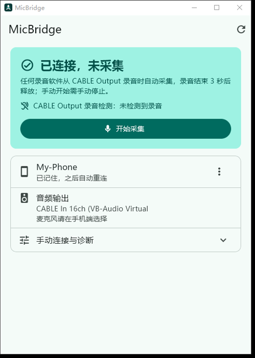
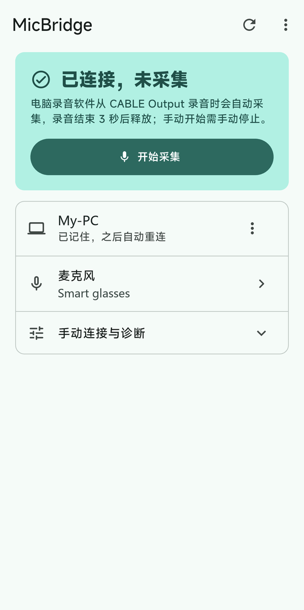
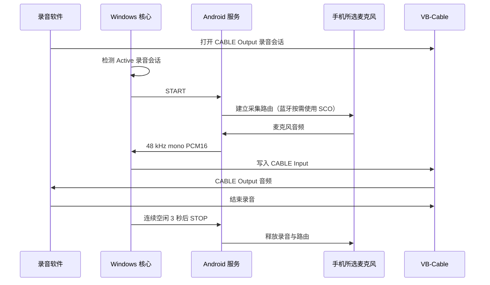

# MicBridge


## 功能

把手机上的麦克风（内置、蓝牙耳机或智能眼镜如 Ray-Ban Meta）通过局域网用作 Windows 麦克风，适用于任何从 CABLE Output 录音的软件。Flutter 是 Android 与 Windows 的唯一界面；Android 的 Kotlin 服务按需采集音频，Windows 的无窗口 .NET 宿主接收音频并写入 VB-Cable。

- 手机内置麦克风、蓝牙耳机、智能眼镜（如 Ray-Ban Meta）均可作为输入；具体可用设备以 Android 暴露的麦克风和通话路由为准。
- 任意从 **CABLE Output** 录音的软件均可使用，Typeless 只是其中一个例子。
- 支持局域网发现、首次审批与记住设备、自动重连，以及按录音活动自动启停或手动采集。

<p>
  
  
</p>

## 工作原理



Windows Flutter 通过 stdin/stdout JSON 行协议启动和控制 `desktop/src/MicBridge.App`；宿主内的 `CoreController` 管理网络与音频。两端都监听 TCP `17891`，默认同时传控制和音频；使用 mDNS 与 UDP `17893` 发现对端。设置 `MICBRIDGE_AUDIO_TRANSPORT=udp` 可启用实验性 UDP `17892` 音频；需要对端支持，否则使用 TCP。

帧格式、认证、发现和 IPC 细节见 [协议说明](protocol/README.md)。

## 前置条件

- Windows 安装 [VB-Cable](https://vb-audio.com/Cable/)；本项目不附带虚拟声卡驱动。
- 在录音软件（如 Typeless）中选择 **CABLE Output**；程序把音频写入 **CABLE Input**。
- 使用手机内置麦克风，或先通过系统蓝牙设置连接耳机／智能眼镜；授予应用请求的麦克风、附近设备及通知权限。
- 两端处于同一可信局域网。Windows 将该可信网络设为 **专用网络（Private）**，并允许应用通过该网络的防火墙；不要通过关闭防火墙解决连接问题。默认需要 TCP `17891` 和发现 UDP `17893`；mDNS 使用 UDP `5353`，实验性 UDP 音频另需 UDP `17892`。网络隔离或禁止广播／组播可能阻止自动发现，此时可手动连接。
- Android **8.0 / API 26** 或更高版本。使用蓝牙设备时须先在系统设置完成连接；能播放蓝牙音频不代表该设备向 Android 提供可用的麦克风路由。
- 开发环境：Flutter（Dart SDK 满足 `^3.13.5`）、Android SDK、JDK 17+、.NET 10 SDK，以及 Flutter Windows 桌面构建工具链。编译和目标 Android SDK 跟随 Flutter 配置。

## 构建与安装

在仓库根目录使用 PowerShell：

```powershell
flutter pub get
flutter build apk --debug
adb install build\app\outputs\flutter-apk\app-debug.apk
flutter run -d windows
```

Windows 发布构建前先退出正在运行的桌面端：

```powershell
flutter build windows --release
```

Windows CMake 会调用 `dotnet publish`，将无窗口宿主 `core/MicBridge.App.exe` 放到 `micbridge.exe` 旁。发布使用 `--no-self-contained`，运行环境需要 .NET 10；分发时保留完整构建目录。构建不会清理 `core/` 中的旧文件。可用 `MICBRIDGE_CORE_PATH` 指定宿主可执行文件路径。

发布 APK 使用 `flutter build apk --release`，签名值通过 `MICBRIDGE_RELEASE_KEYSTORE`、`MICBRIDGE_RELEASE_STORE_PASSWORD`、`MICBRIDGE_RELEASE_KEY_ALIAS`、`MICBRIDGE_RELEASE_KEY_PASSWORD` 环境变量提供；缺少签名配置会失败，不会退回调试签名。

开发验证命令及操作约束见 [AGENTS.md](AGENTS.md)。

更名升级时先卸载旧 Android App，再安装包名为 `io.github.lyyqwq.micbridge` 的新版；两端同时更新后重新配对。新版 Windows 使用 `%LOCALAPPDATA%\MicBridge`，不迁移或删除旧版本的数据目录。分发新版构建时使用 `micbridge.exe` 和 `core/MicBridge.App.exe`。

## 首次配对与日常使用

1. 打开 Windows 桌面端；在手机前台打开应用并授予权限。
2. **首次配对从手机发起**：点击发现的电脑，或展开 **手动连接与诊断**，输入电脑局域网地址与控制端口 `17891`，点击 **连接此地址**。已配对后，双方都可发现和连接已记住的对端；Windows 不能主动发起首次配对。
3. Windows 弹出首次连接审批，在默认 **60 秒** 内仅允许自己的手机。拒绝、关闭或超时都不会建立信任。
4. 在 Android 点击 **麦克风** 打开 **选择麦克风** 面板，默认是 **跟随系统**。需要固定使用手机内置、蓝牙耳机或智能眼镜时选择对应输入；已保存设备未连接时会提示并暂时跟随系统。Windows 的 **音频输出** 行显示 VB-Cable 状态，麦克风在手机端选择。
5. 两端显示 **已连接，未采集** 后，在任意录音软件中选择 **CABLE Output** 并开始录音，即可触发自动采集；也可点击 **开始采集**。看到 **正在采集** 后再说话。手动开始需点击 **停止采集** 释放麦克风。

已记住设备在应用／服务仍运行且网络可达时可自动重连。只有一个可信手机槽位。Windows 的 **忘记设备** 和 Android 的 **忘记电脑** 只清除本端记录；如遇 `repair_required` 或单边忘记造成的身份不一致，两端都忘记后重新连接并允许。

### 按钮、状态与菜单

| 当前状态 | 主按钮与行为 |
| --- | --- |
| 未连接 | Windows 为 **连接手机**，Android 为 **连接电脑**；可直接点击发现条目，或手动连接。 |
| 收到配对请求 / 等待电脑批准 | 主按钮为 **等待配对批准**，不可点击；在 Windows 弹窗中处理。 |
| 已连接，未采集 | **开始采集**。 |
| 正在启动采集 / 正在采集 | **停止采集**；启动过程中也可停止。 |
| 正在停止采集 | **正在停止采集**，不可重复点击。 |
| 需要处理 | 连接仍在时为 **重试采集**，已断开时为 **重新连接**。 |

命令执行期间相关按钮会暂时禁用。两端右上角均有 **刷新**；Android 额外提供 **更多 → 权限检查**（麦克风、蓝牙和通知）。设备摘要行的 **设备操作** 菜单提供 Windows **忘记设备** / Android **忘记电脑**，仅在有可信记录或需要修复配对时出现。

## 设备名称

Windows 显示 **Windows 计算机名**（`Environment.MachineName`），空或空白时回退为 `MicBridge`；Android 显示 **系统设备名称**（`Settings.Global.DEVICE_NAME`），空或空白时依次回退为机型（`Build.MODEL`）、`Android`。

名称仅用于发现与界面显示，不参与身份匹配或 HMAC 认证。已配对设备重连并认证成功后，才以合法、非空的新名称刷新保存的名称；未认证或认证失败的连接不能刷新名称，名称更新不改变设备 ID、配对 ID 或密钥。mDNS 实例标签最多 63 个 UTF-8 字节，HELLO 名称最多 256 个 UTF-16 代码单元且不含控制字符，详见 [协议中的设备名称约定](protocol/README.md#连接与发现)。

## 自动采集规则

- Windows 检测 `CABLE Output` 上任意外部进程的 Active 录音会话。
- 手机已连接且空闲时，录音活动触发 `START`。
- 自动采集在所有录音会话连续空闲 **3 秒** 后发送 `STOP`。期间恢复活动会取消停止，下一次空闲重新计时；短暂停顿保留音频路由。
- `listenerActive` 的空闲防抖为 **1 秒**，与 3 秒停止延迟独立；两者从同一次空闲开始计时，不是先等 1 秒再等 3 秒。
- 手动开始的采集由手动控制，不会被自动策略停止。
- 采集失败后保留已认证控制连接，可手动重试；持续 Active 的同一次录音不会不断自动重试，需经过空闲去抖后的下一次录音活动触发。

## 延迟说明

Windows `NAudioSink` 的 WaveOut 目标缓冲为 **80 ms**，使用两个缓冲块；内部积压超过 **200 ms** 时丢弃旧音频追赶到约 **80 ms**。这些是缓冲配置，不是端到端延迟保证。

Android 使用 4096 字节阻塞读块，按 48 kHz、单声道、16-bit 换算，满块约 **43 ms** 音频；实际读取与调度时间取决于设备。

VB-Cable 自身缓冲、Android 读块、局域网传输以及蓝牙设备冷启动 SCO 建链还会增加延迟。自动采集不能保证保留首字；先确认采集状态再说话，并在实际麦克风设备和录音软件上检查首字和连续录音。3 秒保持只减少短暂停顿后的重新建链。

## 排障

- **找不到电脑或无法连接**：先检查同一局域网、Windows 网络类别及防火墙。Public 配置可能阻止入站；仅对可信家庭网络改为 Private。允许 TCP `17891`、发现 UDP `17893`；启用 UDP 音频时再允许 UDP `17892`。发现失败可手动输入电脑地址。
- **没有声音**：确认录音软件选择 CABLE Output、系统有 CABLE Input，并确认手机已连接且采集开始。核心报 `VB-Cable output device not found` 时检查 VB-Cable 安装。
- **输入设备不可用**：确认权限、蓝牙输入设备连接及麦克风选择。已保存设备断开时，界面可能显示 **已保存的设备未连接，暂按系统默认**；此时音源可能是手机麦克风。
- **配对后仍无法认证**：若只有一端保存或忘记了设备，两端均忘记再配对；不要依赖重试覆盖旧信任。
- **后台或锁屏无法录音**：从手机前台完成权限和连接；系统后台麦克风与厂商省电限制需要真机验证。
- **查看诊断**：核心日志为 `%LOCALAPPDATA%\MicBridge\logs\core.log`；手机 logcat 使用 `MicBridgeControl` 标签。日志用于状态和错误诊断。

## 配对安全与隐私

应用不记录或持久化 PCM 音频。Windows 用当前用户 DPAPI 保护 `%LOCALAPPDATA%\MicBridge\device-trust.dat`；Android 用 Keystore 的 AES-GCM 密钥保护 SharedPreferences `micbridge_device_trust` 中的信任记录，备份与设备转移排除该信任文件。

每次新配对首次批准时，长期密钥会在可信家庭局域网内通过 **明文 TCP 下发一次**；已记住设备重连不再下发密钥。之后使用 **HMAC-SHA256 双向认证**；认证不加密控制消息或音频，也不提供后续数据的密码学完整性保护。能监听首次交换的人可以取得密钥，当前方案不抵御局域网主动中间人。不要用于公共或不可信网络，不要向互联网开放端口。

发现广播不含密钥或认证材料；发现到的设备名和地址不是可信身份。密钥、认证证明和 PCM 不进入日志。

## 已知限制

- 仅支持 **单手机、单可信对端**，使用范围限于可信 LAN；不提供云服务、账号体系、互联网中继或自定义虚拟声卡驱动。
- 自动重连要求 Windows 核心与已启动的 Android 服务仍在运行；不保证开机自启、强行停止后的唤醒或绕过后台权限限制。
- UDP 音频是实验功能，网络不稳定时优先使用默认 TCP。
- 构建和单元测试通过不能证明真机蓝牙路由、锁屏录音或 VB-Cable 音频可用。
- 自动启停依据 CABLE Output 的 Active 录音会话，而非某个软件的按钮；若软件一直保持录音会话活跃，自动采集不会因界面结束录音而停止。
- 蓝牙通话路由、设备兼容性及启动延迟取决于 Android 与外设；不能保证所有耳机／智能眼镜可用或自动保留首字。

## 测试

以下为开发者可执行的验证命令，在仓库根目录使用 PowerShell；命令列出不代表本次已运行或通过：

```powershell
flutter analyze
flutter test
dotnet test desktop/tests/MicBridge.Core.Tests/MicBridge.Core.Tests.csproj -c Release -p:UseSharedCompilation=false
./android/protocol-check/verify.ps1 -JavaExecutable "<jdk-java-executable>"
```

`<jdk-java-executable>` 替换为 JDK 17+ 的 `bin/java.exe` 路径。协议检查依赖脚本指定版本的 Gradle 缓存 JAR，先完成 Android 构建准备缓存。.NET 测试包含真实网络用例，需要预留数分钟。

Flutter 测试覆盖界面、状态竞争及平台桥接；.NET 测试覆盖自动采集、音频积压、信任、发现、网络与宿主 IPC；Kotlin 检查覆盖认证证明、设备名称、发现及候选失败策略。实际设备仍需验证首次审批、重连、双端忘记、首字、连续录音、停止释放、断连、后台和锁屏。分别检查手机内置与实际使用的蓝牙输入，以及目标录音软件的 CABLE Output 行为；不要用单元测试结果代替真机音频验证。

## 仓库结构

- `lib/`、`test/`：双端 Flutter 界面、平台桥接与界面测试。
- `android/app/src/main/kotlin/io/github/lyyqwq/micbridge/`：Android 服务、设备选择、采集、信任与协议；包名为 `io.github.lyyqwq.micbridge`。
- `desktop/src/MicBridge.App/`：无窗口宿主、Flutter IPC 与日志入口。
- `desktop/src/MicBridge.Core/`：连接、认证、自动采集策略与 VB-Cable 输出。
- `desktop/tests/MicBridge.Core.Tests/`：核心与宿主测试。
- `android/protocol-check/`、`protocol/`：Kotlin 协议验证与共享协议说明。
- `windows/`：Flutter Windows runner 与 .NET 宿主打包配置。
- `.trellis/spec/`：分层开发规范。

## License

Copyright (C) 2026 lyyQwQ

本项目采用 [GPL-3.0-or-later](LICENSE) 许可证。
