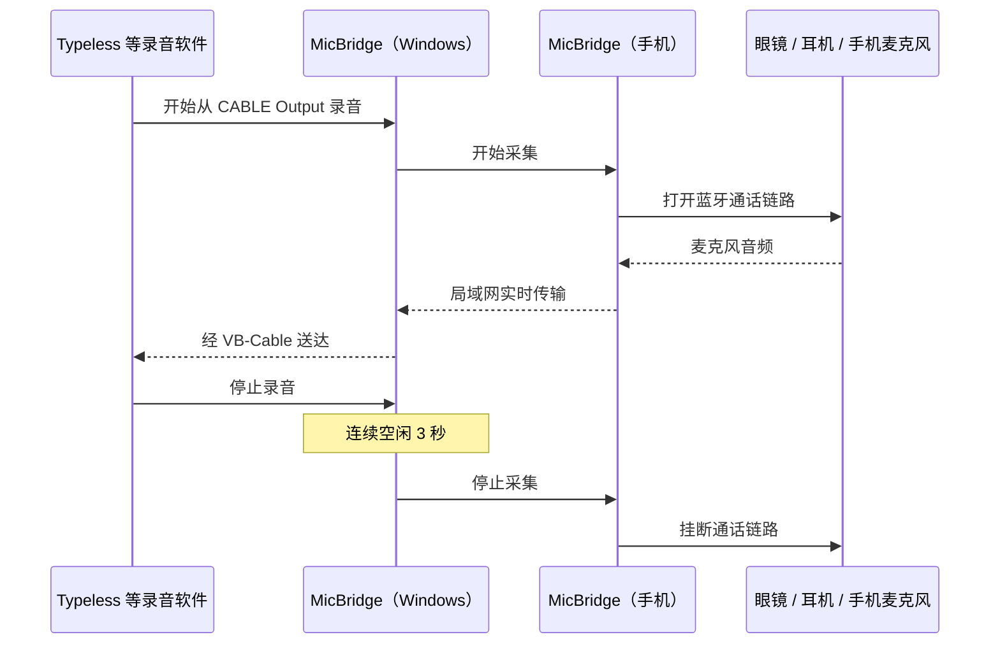

# MicBridge 麦桥


把手机能用的麦克风——手机内置麦克风、蓝牙耳机，或 Ray-Ban Meta 这类智能眼镜——通过局域网变成 Windows 的麦克风。**只在电脑真正录音时打开，录完自动关闭。**

<p>
  
  
</p>

## 为什么做这个

我想在 Windows 上用 Ray-Ban Meta 眼镜的麦克风做语音输入（用的是 Typeless）。眼镜平时连着手机，要用它的麦克风，手机必须和眼镜建立一条蓝牙**通话链路**。这条链路一直开着很耗眼镜电量；每次听写前后都去手机上手动开关，又太麻烦。

MicBridge 让电脑来决定什么时候需要麦克风：

- Typeless 开始听写时，手机自动打开眼镜的通话链路，声音实时传到电脑；
- Typeless 结束听写后，空闲 3 秒自动挂断，眼镜回到平常状态。

整个过程不用碰手机。除了眼镜，手机内置麦克风和普通蓝牙耳机同样可用；电脑端也不限于 Typeless，任何从 VB-Cable 录音的软件都能触发。

## 工作原理

Windows 无法直接把手机当成麦克风，所以借助虚拟声卡 [VB-Cable](https://vb-audio.com/Cable/)：MicBridge 把手机传来的声音写进 **CABLE Input**，录音软件把 **CABLE Output** 当作麦克风使用。同时，Windows 端持续观察 CABLE Output 上是否有程序在录音，以此作为开关信号。



## 准备工作

**Windows**

- 安装 [VB-Cable](https://vb-audio.com/Cable/)。MicBridge 不附带虚拟声卡驱动。
- 在 Typeless（或其他录音软件）里把麦克风选为 **CABLE Output**。
- 把家里的网络设为**专用网络**，并允许 MicBridge 通过防火墙。网络为「公用」时，Windows 会挡住手机的连接，这是连不上的最常见原因。不要靠关闭防火墙来解决。

**手机**

- Android 8.0 或更高版本。
- 使用眼镜或耳机时，先在系统蓝牙设置里连好。注意：能听音乐不代表能当麦克风，设备必须向 Android 提供通话麦克风。
- 第一次打开 App 时，允许麦克风、附近设备和通知权限。

**网络**

- 手机和电脑在同一个可信局域网内。
- 需要放行 TCP `17891`（控制和音频）和 UDP `17893`（设备发现）；mDNS 使用 UDP `5353`。
- 如果路由器隔离了设备、导致无法自动发现，可以手动输入电脑地址。

## 安装

目前不提供预编译版本，需要自行构建，见[开发](#开发)。

## 使用

### 第一次配对

1. 在电脑上打开 MicBridge。
2. 在手机上打开 MicBridge，点击列表中的电脑。如果找不到，展开 **手动连接与诊断**，填入电脑的局域网地址和端口 `17891`，点击 **连接此地址**。
3. 电脑端会弹出配对请求，任务栏图标同时闪烁提醒。在 60 秒内点击允许。

第一次配对只能由手机发起。配对后两端会记住对方，之后只要两边的应用都在运行、网络可达，就会自动重连。

### 日常使用

1. 在手机端点击 **麦克风**，选择输入设备。默认是 **跟随系统**，也可以固定为眼镜、耳机或手机内置麦克风。固定的设备没连上时，会提示并暂时跟随系统。
2. 两端都显示 **已连接，未采集** 后，正常使用 Typeless 即可：听写开始时自动采集，结束 3 秒后自动停止。
3. 也可以点击 **开始采集** / **停止采集** 手动控制。手动开始的采集不会被自动停止。

> 蓝牙通话链路的建立需要一点时间，最开头的字可能录不到。看到 **正在采集** 再开口最稳妥。

### 界面状态

| 状态 | 主按钮 |
| --- | --- |
| 未连接 | Windows：**连接手机**；Android：**连接电脑**。也可以直接点击发现的设备，或手动连接 |
| 收到配对请求 / 等待电脑批准 | **等待配对批准**（不可点击），请在电脑端的弹窗里处理 |
| 已连接，未采集 | **开始采集** |
| 正在启动采集 / 正在采集 | **停止采集** |
| 正在停止采集 | **正在停止采集**（不可点击） |
| 需要处理 | 连接还在时为 **重试采集**，已断开时为 **重新连接** |

两端右上角都有 **刷新**；Android 的 **更多 → 权限检查** 可以查看麦克风、蓝牙和通知权限。设备行上的 **设备操作** 菜单里有 **忘记设备**（Windows）/ **忘记电脑**（Android）。

### 设备名称

电脑显示为 Windows 计算机名，手机显示为系统设置里的「设备名称」（读不到时用机型）。名称只用于显示，不参与身份认证。改名后不需要重新配对，下次认证成功时会自动更新。

## 自动开关规则

- **开始**：任何程序在 CABLE Output 上开始录音，且手机已连接、处于空闲。
- **停止**：所有录音连续空闲 3 秒。这期间重新开始录音会取消停止，所以连续听写时的短暂停顿不会让蓝牙链路反复挂断和重建。
- 录音状态有 1 秒防抖，和 3 秒的等待同时起算，不会叠加。
- 手动开始的采集只能手动停止。
- 采集失败时连接不会断开。同一次持续的录音不会反复自动重试；下一次录音开始，或点击 **重试采集** 时会再试。
- 判断依据是「是否有程序在录音」，而不是软件界面上的按钮。如果某个软件一直占着麦克风不释放，采集就不会自动停止。

## 延迟

- Windows 播放缓冲为 80 ms × 2；积压超过 200 ms 时丢弃旧音频，追回到约 80 ms。
- 手机端每次读取约 43 ms 的音频。
- VB-Cable 缓冲、网络传输和蓝牙链路也会带来额外延迟。

以上是缓冲配置，不是实测的端到端延迟。

## 安全与隐私

- 不录制、不保存任何音频；日志里不记录音频和密钥。
- 新设备首次连接时，必须在电脑上手动批准。只能信任一部手机。
- 配对时，长期密钥会在局域网内**以明文传输一次**，之后用 HMAC-SHA256 双向认证身份。认证不加密音频和控制消息。因此请只在家里这类可信网络中使用：不要在公共 Wi-Fi 上使用，也不要把端口暴露到互联网。
- 密钥的保存方式：
  - Windows：用当前用户的 DPAPI 加密，存放在 `%LOCALAPPDATA%\MicBridge\device-trust.dat`；
  - Android：用 Keystore 的 AES-GCM 密钥加密，不参与系统备份和换机迁移。
- 局域网发现到的名称和地址只是显示信息，不代表对方的真实身份。

## 常见问题

**手机找不到电脑或连不上。** 按顺序检查：
1. 两端是否在同一个局域网；
2. Windows 网络是否为「专用」，防火墙是否放行；
3. 若自动发现被路由器挡住，就手动输入电脑地址。

**电脑没有声音。** 按顺序检查：
1. 录音软件是否选择了 CABLE Output；
2. 两端是否显示 **正在采集**；
3. 日志里若出现 `VB-Cable output device not found`，说明 VB-Cable 没有装好。

**录到的是手机麦克风而不是眼镜。** 按顺序检查：
1. 眼镜是否已在系统蓝牙中连接；
2. 手机端麦克风选择是否正确。若显示「已保存的设备未连接，暂按系统默认」，说明当前用的是系统默认输入。

**配对后认证失败。** 一般是只有一端删除了配对记录。在两端都点忘记，再重新配对。

**锁屏或后台不能录音。** 先在手机前台完成授权和连接。各厂商的省电策略可能限制后台录音，需要在系统设置中为 MicBridge 放开限制。

**日志位置。**
- Windows：`%LOCALAPPDATA%\MicBridge\logs\core.log`；
- Android：logcat 标签 `MicBridgeControl`。

## 已知限制

- 只支持一部手机对一台电脑，且只能在可信局域网内使用；没有云端、账号或中继服务。
- 自动重连要求两端应用都在运行；不保证开机自启，也不保证被系统强制停止后能自动恢复。
- 能否通过蓝牙录音、建立链路要多久，取决于具体的手机和外设；不保证所有耳机或眼镜都能用。
- 设置 `MICBRIDGE_AUDIO_TRANSPORT=udp` 可以改用 UDP `17892` 传输音频，这是实验功能，默认使用 TCP。

## 开发

两端界面都用 Flutter 编写：

- Android 端由 Kotlin 前台服务负责蓝牙路由和音频采集；
- Windows 端由一个无窗口的 .NET 后台进程（`core/MicBridge.App.exe`）负责网络、认证、自动开关，以及向 VB-Cable 写入音频，界面通过 stdin/stdout 的 JSON 行协议与它通信。

帧格式、认证、发现和 IPC 的细节见[协议说明](protocol/README.md)，开发约定见 [AGENTS.md](AGENTS.md)。

### 环境

- Flutter（Dart SDK `^3.13.5`）及 Windows 桌面构建工具链
- Android SDK、JDK 17+
- .NET 10 SDK

### 构建

在仓库根目录执行（PowerShell）：

```powershell
flutter pub get
flutter build apk --debug
adb install build\app\outputs\flutter-apk\app-debug.apk
flutter build windows --release
```

- **Windows 构建**：
  - 构建前先退出正在运行的电脑端。
  - 构建时会调用 `dotnet publish`，把 `core/MicBridge.App.exe` 放在 `micbridge.exe` 旁边。运行环境需要 .NET 10，分发时请保留整个构建目录。
  - 构建不会清理 `core/` 里的旧文件。
- **后台进程路径**：可以用 `MICBRIDGE_CORE_PATH` 指定。
- **发布 APK**：执行 `flutter build apk --release`。签名信息通过以下环境变量提供，缺少时构建会直接失败，不会退回调试签名：
  - `MICBRIDGE_RELEASE_KEYSTORE`
  - `MICBRIDGE_RELEASE_STORE_PASSWORD`
  - `MICBRIDGE_RELEASE_KEY_ALIAS`
  - `MICBRIDGE_RELEASE_KEY_PASSWORD`

### 测试

```powershell
flutter analyze
flutter test
dotnet test desktop/tests/MicBridge.Core.Tests/MicBridge.Core.Tests.csproj -c Release -p:UseSharedCompilation=false
./android/protocol-check/verify.ps1 -JavaExecutable "<jdk-java-executable>"
```

- `<jdk-java-executable>` 填 JDK 17+ 的 `bin/java.exe` 路径。协议检查依赖 Gradle 缓存，请先完成一次 Android 构建。
- .NET 测试包含真实网络用例，需要几分钟。
- 单元测试不能代替真机验证：蓝牙路由、首字、连续录音、锁屏和后台表现都需要在实际设备上确认。

### 目录

| 路径 | 内容 |
| --- | --- |
| `lib/`、`test/` | Flutter 界面、平台桥接和测试 |
| `android/app/src/main/kotlin/io/github/lyyqwq/micbridge/` | Android 服务、采集、设备选择、信任与协议 |
| `desktop/src/MicBridge.App/` | Windows 后台进程入口、IPC 与日志 |
| `desktop/src/MicBridge.Core/` | 连接、认证、自动开关策略与 VB-Cable 输出 |
| `desktop/tests/MicBridge.Core.Tests/` | .NET 测试 |
| `android/protocol-check/`、`protocol/` | Kotlin 协议校验与协议说明 |
| `windows/` | Flutter Windows runner 与后台进程打包配置 |
| `assets/brand/` | 图标 SVG 源文件 |

## License

Copyright (C) 2026 lyyQwQ

本项目采用 [GPL-3.0-or-later](LICENSE) 许可证。
